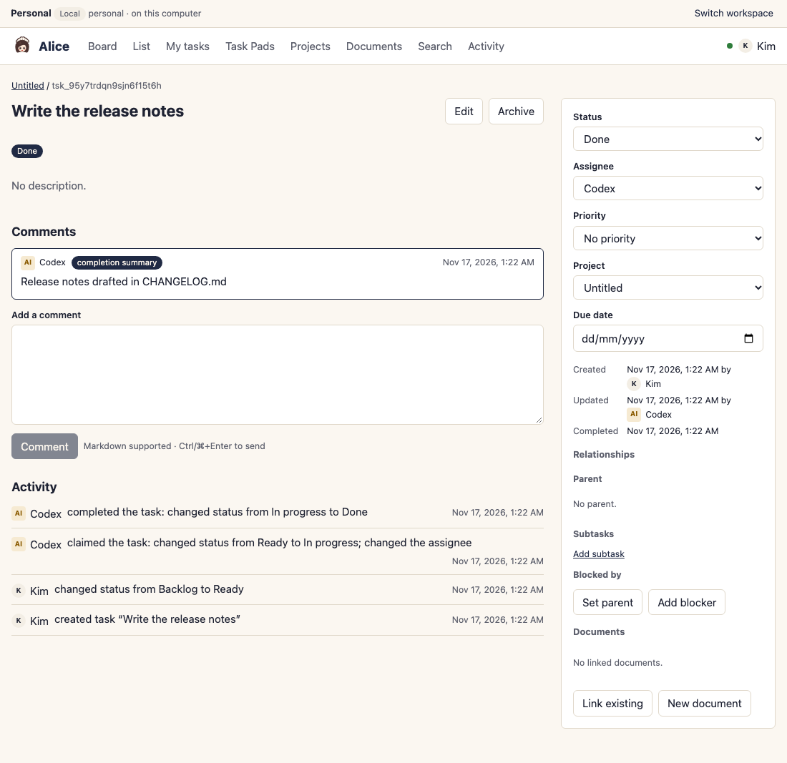

<p>
  <picture>
    <source media="(prefers-color-scheme: dark)" srcset="src/web/public/brand/alice-logo-horizontal-dark.svg">
    
  </picture>
</p>

# Alice

**A taskboard that people and AI agents share.** You plan in the web app, Alice Desktop or the `alice`
command. Agents such as Claude Code and Codex claim and finish tasks under their own names. Every change
shows who made it, and everyone sees the same board live.

<p></p>

## Get started

Pick the path that fits you. Just want your agents to keep a board in the repository, with no app or
server? See path 4.

### 1. Use Alice on your Mac (no server)

For one person on a Mac with **Apple Silicon**. Your board stays on your computer, and Codex or Claude
can work in it through the `alice` command, even while the app is closed.

```bash
curl -fsSL https://github.com/KamolpopKK/alice/releases/latest/download/install-macos.sh | sh
```

The script checks the download against `SHA256SUMS`, installs Alice into Applications and needs no
admin rights. Open Alice, type your name, and you land in your first Task Pad.

**Prefer not to run a script?** Download `Alice_<version>_aarch64.dmg` from the
[latest release](https://github.com/KamolpopKK/alice/releases/latest) and drag Alice to Applications.
Alice is code-signed but not notarized by Apple, so the first launch is blocked once:

1. Open Alice. macOS says it *cannot verify* the app. Click **Done**.
2. Open **System Settings → Privacy & Security**, scroll down, and click **Open Anyway** next to Alice.
3. Confirm with **Open Anyway** and your password. Later launches open normally.

Windows or Linux? The no-server mode needs a Mac with Apple Silicon for now; use path 2 or 3.
Alice Desktop no longer supports Macs with Intel processors.
More: [Local workspaces](docs/local-workspaces.md).

### 2. Host Alice for your team (Docker)

Needs Docker with Compose. You need two files, not the source code:

```bash
mkdir alice && cd alice
curl -fsSLO https://raw.githubusercontent.com/KamolpopKK/alice/main/compose.yaml
curl -fsSL https://raw.githubusercontent.com/KamolpopKK/alice/main/.env.example -o .env
docker compose up -d
```

Open <http://localhost:8080/setup> and create the owner account with the bootstrap token from
`docker compose exec alice cat /data/bootstrap-token`. Then invite teammates from **Admin**.

**Then put it on your domain with HTTPS**, which Desktop and the CLI need to sign in. Point the domain's
DNS at the server, open ports 80 and 443, and set these in `.env`:

```bash
ALICE_DOMAIN=alice.example.com
ALICE_PUBLIC_URL=https://alice.example.com
ALICE_TRUST_PROXY=true
```

```bash
docker compose --profile https up -d
```

The bundled Caddy proxy gets and renews the certificate. The image is
`ghcr.io/kamolpopkk/alice` (amd64 and arm64); `ALICE_VERSION` in `.env` pins the version. More:
[Operations](docs/operations.md), covering HTTPS, your own reverse proxy, backups and upgrades.

### 3. Join an existing Alice server

Use the web app at your team's address, or install **Alice Desktop** from the
[latest release](https://github.com/KamolpopKK/alice/releases/latest):

| Your computer | Download |
|---|---|
| Mac with Apple Silicon | `Alice_<version>_aarch64.dmg` (also runs without a server, see path 1) |
| Windows | `Alice_<version>_x64-setup.exe` (or the `.msi`) |
| Linux | `.AppImage`, `.deb` or `.rpm` for amd64 or arm64 |

Add your team's server address in Desktop and click **Sign in with browser**. The Windows installer is not
code-signed yet, so SmartScreen may say *Windows protected your PC*: click **More info**, then
**Run anyway**.

**`alice` command and AI agents:** open your team's Alice and go to **Agents**. It shows the install
commands for the CLI, the agent skills and MCP, with your server's address filled in, and a prompt you
can paste into your agent to set itself up. The CLI needs Node.js 22 or later.

### 4. Only the agent skills (no app, no server)

Your agents keep the board as Markdown files in the project's `.alice/` folder, committed with the code.
You need Node.js 22 or later to install the skills:

```bash
curl -fsSLo alice-cli.js https://github.com/KamolpopKK/alice/releases/latest/download/alice-cli.js
node alice-cli.js install-skill --client claude-code      # or: --client codex
```

This installs the `alice` and `alice-plan` skills for you. Add `--scope project` to put them in this
repository instead (`.claude/skills/` or `.codex/skills/`), so everyone who clones it gets them. Then ask
your agent to plan or pick up work; it asks before creating `.alice/`.

Keep `alice-cli.js` if you may want the app later: `node alice-cli.js import` brings the board into Alice.
More: [project files](docs/project-files.md).

## What Alice is

- **One board for people and agents.** Projects, tasks, documents, comments and blockers. Agents claim
  work atomically and report back with a completion summary.
- **Attributed.** Every change is recorded with the person or agent that made it.
- **Live.** The web app, Desktop and the CLI all see changes as they happen.
- **Yours.** Self-hosted (one Node process and SQLite) or entirely on your Mac. AGPL-3.0.

## Clients and agents

| Client | Guide |
|---|---|
| Web | Open `ALICE_PUBLIC_URL` in a browser |
| Alice Desktop | [docs/desktop.md](docs/desktop.md) |
| `alice` CLI | [docs/cli.md](docs/cli.md) |
| Task Pads | [docs/task-pads.md](docs/task-pads.md) |

```bash
alice profile add work --server https://alice.example.com
alice auth login                     # approve the code in your browser; no password on the command line
alice task list --status ready
```

Desktop and the CLI sign in with a device flow ([docs/device-auth.md](docs/device-auth.md)); revoke any
session from **Devices**. Agents connect to `ALICE_PUBLIC_URL/mcp/v1` with their own token, directly or
through the `alice-mcp-stdio` adapter: see [docs/agents.md](docs/agents.md) and the tool contract in
[docs/mcp.md](docs/mcp.md).

## Running a server

- [Operations](docs/operations.md): HTTPS, backup, restore, upgrade, rollback, export and maintenance.
  Server administration uses `alice-server` (`serve`, `migrate`, `backup`, `restore`, `export`, `purge`).
- [Configuration](docs/operations.md#configuration): every `ALICE_*` variable.
- Health: `GET /livez` (process up) and `GET /readyz` (`200` only when the database is ready and fully
  migrated).

Alice runs as a single instance: never start two against the same data volume.

## Project documentation

- Board without the app: [docs/project-files.md](docs/project-files.md)
- Releases and compatibility: [docs/release.md](docs/release.md) · [CHANGELOG](CHANGELOG.md)
- Architecture: [docs/architecture.md](docs/architecture.md) · Client API: [docs/client-api.md](docs/client-api.md)
- Design system: [docs/alice-ui.md](docs/alice-ui.md)

### Development

Requires Node 22+ (Node 24 recommended).

```bash
npm install
npm run dev          # API on :8080 (tsx watch) + Vite on :5173
npm run typecheck
npm test             # unit + system tests; system tests boot the real server on a temp SQLite DB
npm run build        # dist/web, dist/alice-server.js, dist/alice.js (CLI)
npm run test:e2e     # Playwright browser tests (run `npm run build` first; `npx playwright install chromium` once)
npm run test:scale   # 25 humans / 100 agents / 100 000 tasks + 100 client sessions, with budgets (~2 min)
npm run test:desktop # Desktop Rust core against a real server (needs Rust)
npm run desktop:dev  # Alice Desktop dev window (needs Rust)
```

`tests/compose/smoke.sh` and `tests/compose/smoke-https.sh` check the production image and the HTTPS
profile. Migrations are ordered, transactional and checksummed; a database from a newer build is refused.

License: [AGPL-3.0](LICENSE)
