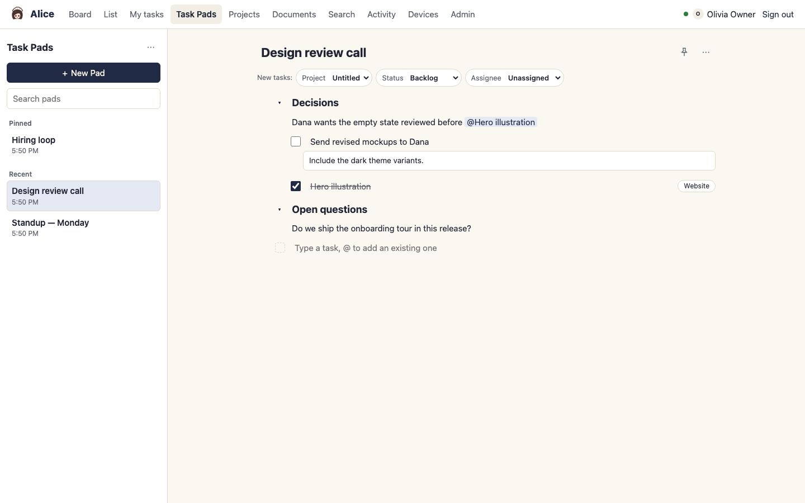
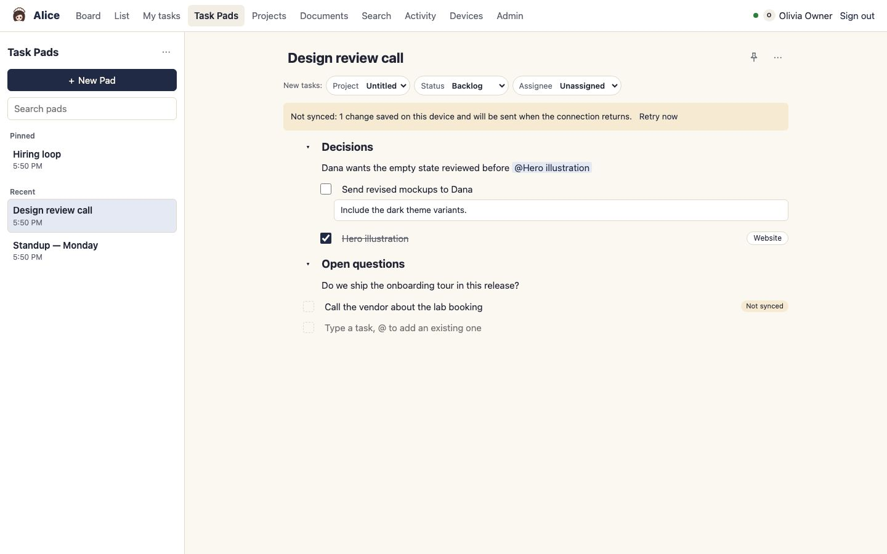

# Task Pads

Task Pads are private notepads for capturing work while you listen: during a call, a meeting or an
interruption. Lines you mark as **Task** become real Alice tasks the moment you press Enter. **Text** and
**Heading** lines stay yours and never reach the Board.

## Pads

- **Open Task Pads** from the main navigation. On a wide window, your pads are listed on the left and the
  selected pad is on the right. On a narrow window (phones, small Desktop windows) the list and the pad are
  separate screens; **Back to pads** returns to the list.
- **New Pad** creates a pad named with the current date and time (in your language and time zone) and puts
  the cursor on its first task line. There is no naming dialog. Rename it any time with the title field;
  names do not need to be unique.
- **Pinned** pads stay at the top (pin button next to the title). Other pads are ordered by when they were
  last changed. Wide windows open the pad you used last on this device.
- **Archive** (⋯ → Archive pad) is the normal way to put a pad away. Archived pads are listed under the
  sidebar's ⋯ → **Archived pads**, where you can open, restore, or delete them.
- **Delete permanently** asks for confirmation and removes the pad and its notes for good. Tasks created
  from it stay on the Board unchanged.
- **Search** in the sidebar looks through pad names, headings, text and task titles in all of your pads,
  including parts of long pads that have not been loaded yet. Choosing a result opens the pad, expands
  collapsed sections, scrolls to the line and puts the cursor there.

## Writing

| You want to | Do this |
|---|---|
| Capture a task | Type on the empty line and press **Enter**. The task is created right away and the next task line is ready. |
| Write a note | **Ctrl/⌘ + /** → Turn into Text (or use the ⋮⋮ handle). Enter after Text starts more Text. |
| Start a section | Turn a line into a **Heading**. Enter after a Heading starts Text inside that section. Use the ▾ button to collapse it. |
| Nest or un-nest | **Tab** / **Shift+Tab** on Text and Heading lines; on any line **Alt+Shift+→ / ←**. Up to four levels. |
| Move a line | **Alt+Shift+↑ / ↓**, the menu (Move up/down), or drag the ⋮⋮ handle. A Heading moves with everything inside it. |
| Add a task description | **Tab** from a task title. Markdown works (paragraphs with Shift+Enter, `-` bullets, `1.` lists). Leave with Enter on an empty last line (Enter twice), **Shift+Tab** on a new empty line, **Ctrl/⌘+Enter** (next task) or Escape. |
| Refer to existing work | Type **@** and part of a title or a task id. On an empty task line, choosing a task places it here; if it already has a line in a pad, a mention is inserted instead. In Text, Headings and descriptions, **@** inserts a mention. Clicking a mention or a task (↗) opens it in a side panel. |
| Paste several lines | Alice always asks: **Create tasks** (one per non-blank line, all or nothing, titles over 300 characters are named first), **Paste as text**, or **Cancel**. Formatting from other apps is removed in Text and Headings. |
| Finish a task | Tick its box. Unticking restores the status it had before (Backlog if unknown). ⋯ → **Remove completed tasks** clears finished lines from the pad; the tasks stay on the Board. |
| Undo | **Ctrl/⌘+Z** undoes typing, conversions, nesting, moves, removals and task capture for this session. Undoing a captured task archives that task (never deletes it); undoing a paste removes the whole batch. |

Rules that keep work safe:

- Nothing can be nested under a Task, so a task never silently becomes a sub-task. Group tasks under a
  Heading or a Text line instead.
- Turning a Task line into Text keeps its title as text and leaves the task untouched. Turning Text into a
  Task creates a new task. **Turn into description…** is the only way to fold a task into another task's
  description, and it asks first.
- Removing a Task line from a pad (menu → Remove from pad, or deleting it) never archives or deletes the
  task. If a task is archived elsewhere its line shows *Archived* with Restore and Remove from pad.
- Deleting a line moves its nested lines up one level. **Delete with nested lines…** is a separate, confirmed
  action.

## New tasks and pad defaults

Without defaults, a captured task goes to **Untitled**, status **Backlog**, unassigned, no priority. The
*New tasks* chips under the title set a default **Project**, **Status** and **Assignee** for this pad.
They apply only to tasks created afterwards; existing tasks are never changed. If a default project is
archived later, capture explains the problem and creates nothing until you change the chip. Priority, due
date and labels are edited in the task's side panel.

Task title, description, status and the rest are the real task fields: a change in the pad shows up on the
Board, in Task Detail, in the CLI and for agents, and the other way round. Task changes made from a pad
appear in task activity with source `task_pad`. Your text, headings, ordering, pins and collapsed sections
never appear in workspace activity.

## Privacy

Pads belong to one person. Other people, agents, the CLI and MCP cannot list, read, search or change them,
and a pad link opened by someone else looks exactly like a page that does not exist. Pad changes are sent
only to your own sessions. Tasks you create from a pad are ordinary shared tasks and visible to everyone,
like any other task.

Operators can still see pad tables in server backups (see [operations.md](operations.md#backup)), so treat
backups as sensitive.

## Saving, connection problems and other devices

Every change saves automatically. A small dot next to a line means it is being saved.

- **Not synced.** If Alice cannot reach the server, you can keep typing and capturing. Lines that are not on
  the server yet are labelled *Not synced* and a banner shows how many changes are waiting. They are kept
  in this browser (or in Alice Desktop) and survive a reload or restart; they are sent in order as soon as
  the connection returns, or when you choose **Retry now**. Each change carries an id, so a retry can never
  create a task twice.
- **Not yet on the Board.** A task waiting to be sent is only on your screen. Nobody else sees it until the
  server has accepted it.
- **Failed.** If the server rejects a change (for example, the pad's default project was archived), the line
  keeps its text and shows the reason with **Retry** and **Discard**.
- **Two devices.** Your other open windows and Desktop update live. Edits to different lines merge. If two
  devices change the same line, the later one wins and the device that lost shows *This line was updated on
  another device*.
- The local copy only protects changes that have not been sent. It is not an offline copy of your pads.

## Shortcuts

| Where | Shortcut | Action |
|---|---|---|
| Alice Desktop, from any app | Option+Space (macOS), Ctrl+Alt+Space (Windows, Linux) | Open the last pad on a new task line |
| Alice Desktop, from any app | Option+Shift+Space (macOS), Ctrl+Alt+Shift+Space (Windows, Linux) | New date-and-time pad |
| Browser tab or Desktop window in front | Alt+Shift+P | Open the last pad on a new task line |
| Browser tab or Desktop window in front | Alt+Shift+N | New date-and-time pad |

Change or turn them off in the sidebar ⋯ → **Capture shortcuts…**. Desktop details (reserved keys,
conflicts, what happens when you are signed out) are in [desktop.md](desktop.md#task-pad-capture-shortcuts).

## Export

The sidebar ⋯ → **Export my pads** downloads `alice-pads-<date>.json` with your pads: names, pins,
archive state, defaults, the line hierarchy, text and headings, mentions (by task id), and the ids of the
tasks on task lines. Task records themselves are part of the workspace export (`alice-server export`), which
does not contain anyone's pads. The same file is available from `GET /client/v1/pads/export`.

## Troubleshooting

| Symptom | What to do |
|---|---|
| Task Pads is missing from the navigation | The server is older than this feature (no `task-pads` capability in `/client/v1/info`). Upgrade the server. |
| A line stays *Not synced* | Check the connection banner. Choose **Retry now**. The change is kept until it is sent or you discard it. |
| A line shows a red error | Read the message, fix the cause (for example a pad default), then **Retry**, or **Discard** the line. |
| "Nothing can be nested under a Task" | Put the line under a Heading or Text line, or turn the task into description text explicitly. |
| A Desktop shortcut does nothing | Open **Capture shortcuts…**: the shortcut may be *reserved* or *could not be registered* because another app uses it. Pick another one. |
| A pad link says "Pad not found" | The pad was deleted, or it belongs to someone else. |

## Not included

Task Pads intentionally do **not** offer: AI extraction or rewriting, shared or team pads, comments,
presence or live cursors, character-level merging, images, files, tables or other block types, pad version
history, pad access for agents, MCP or the CLI, task sub-tasks created by indentation, custom fields, or
offline reading of whole pads.

## For developers and operators

- Data: migration 11 adds `pads`, `pad_blocks`, `pad_mutations`, a private FTS index (`pad_search_docs`,
  `pad_search_index`) and the `audience_id`/`origin` columns on `client_events`.
- API: [client-api.md](client-api.md#task-pads). Capability `task-pads`; no new Client API version.
- Domain: `src/server/domain/pads.ts` (Pads, blocks, ordering, search, export) and
  `src/server/domain/pad-tasks.ts` (task integration). Order keys: `src/server/domain/order-keys.ts`.
- Web: `src/web/pads/` (editor model and outbox in `model.ts`, `outbox.ts`, `registry.ts`).
- Desktop: `src-tauri/src/shortcuts.rs`.
- Backups include pads; the workspace export does not; `alice-server purge --archived` removes task lines
  of purged tasks and clears pad defaults that point at purged projects.
