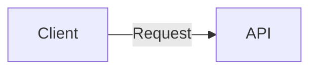

# Shared output formats

These conventions apply to selected content, not a requirement to create every document type. Keep
existing Alice document metadata and project-file front matter unchanged. Do not introduce a second
approval status or revision counter in the Markdown body; Alice maintains revisions.

## Document identity and splitting

At the start of each document body, use these fields in this order. They may sit inside the template's
opening references section; use the same labels for a brief, design, planning reference or a separate
supporting document. Task descriptions keep their existing task templates.

```markdown
# <Title>
- Type: <Brief | Technical design | Planning reference | Architecture | Contract | Data model | other relevant type>.
- Scope: <the subject and boundaries of this document>.
- Source: <originating request/agreement, or source document/task title and id/path, with section/requirement ids when relevant>.
- Related documents: <title + id/path + section — why the reader needs it; repeat when needed>.
```

Type, Scope and Source are required; omit Related documents when none apply. Keep this header short,
with detailed constraints and explanations in the relevant sections. These are Markdown fields, not
new application metadata or front-matter keys. Existing documents need not be reformatted unless an
update is requested.

Default to a brief and a separate technical design. Split a topic out only when it is shared across
several pieces of work, needs to be updated independently, or makes the main document difficult to
read. Do not generate a file per topic automatically or create a separate artifact index. A supporting
document uses the header above and the relevant section format from the originating skill's template.
Apply the same content approval before saving a split or changing an existing source.

Keep the full detail in one authoritative source. The main document retains a useful summary and a
reference explicitly naming where the full detail lives, for example "Contract details: Notifications
API (D-099) § Create notification". The extracted document references its parent/source document when
available. Use a title while a new document is awaiting its id, then resolve actual ids/paths before
finishing the save; do not invent ids. If only part of a multi-document save succeeds, report what was
saved and which references remain to be resolved, naming documents by title in conversation.

Do not copy evolving details into several documents. Read relevant sections of the referenced source
before relying on them; if sources conflict, surface the discrepancy and agree which is correct before
continuing. Reuse existing requirements and technical decisions rather than rewriting them elsewhere.

## Requirement references

- Assign `REQ-001`, `REQ-002`, … within the source brief, including quality and transition requirements.
  Use the next unused number. Keep an existing id when editing; never renumber or reuse removed ids.
  Record retired ids and the reason in Decisions so existing references remain understandable.
- Inside the source brief, use the local id. In another document or task, cite
  `<source brief id or path> / REQ-001`. Before a new brief is saved, local ids suffice; no self-id
  placeholder or extra save is needed.
- For older sources without ids, cite the document id/path and section. Do not invent ids or rewrite
  the source just to add them; propose assigning ids when an update to that source is requested.
- Reference requirements that the design or task actually covers. Infrastructure or investigation work
  may instead cite its supporting design decision or spike question; do not fabricate a requirement.

## Diagrams

Keep diagram source in a fenced `mermaid` block inside its relevant section. Use:

| Meaning | Syntax |
|---|---|
| Components, architecture boundaries, UI or business flow | `flowchart LR` or `flowchart TD`; `subgraph` for boundaries |
| Calls, events and their order | `sequenceDiagram` |
| Lifecycle and allowed transitions | `stateDiagram-v2` |
| Entity relationships | `erDiagram` |

Use these common forms by default; do not require `architecture-beta`, custom icons, scripts or an
external renderer to read the source. A diagram is optional when prose or a table explains the content
more clearly. It does not replace contract details, business rules or acceptance conditions.

Use this wrapper for every diagram; replace the example with the relevant source:

````markdown
### <Diagram title>
Purpose: <the relationship or flow this diagram explains>.



Explanation: <what the reader should learn; define boundaries, edge meanings and any notation used>.
````

Keep node/participant ids stable within the diagram and use meaningful labels. Label edges when their
meaning is not obvious. Distinguish current and proposed behaviour in the title or explanation. Split
large diagrams by concern rather than shrinking them into an unreadable single view.

Alice renders Mermaid locally in Markdown content and previews, with source available; invalid diagrams
show an error and the source. External resources are not supported. Do not claim a diagram was
rendered or syntax-validated unless that check was actually performed. Under `alice-spec`, every check
execution requires the person's prior approval.

## Small task description

Use this for the direct small-task route in think, or work that becomes one task after questioning.
Replace every placeholder; keep the headings. Source references are included only when available.

```markdown
## Outcome
<The observable change.>

## Context
<Known behaviour, relevant paths/symbols, source references and reproduction steps for a bug.>

## Acceptance conditions
1. <A checkable outcome. Cite source requirement ids when available.>

## Verification
- <How to check it is done. This is a proposed check, not a claim it was executed.>
```

## Spike task description

Use the same description format for agreed spikes from think and spec. A saved brief or design is not
required. Keep the headings and replace every placeholder.

```markdown
## Question
<The one question this spike must answer.>

## Context
<Why it matters, known constraints, evidence and source ids/paths when available.>

## Investigation
<What to inspect or prototype and the boundaries of the investigation.>

## Expected output
<The finding, comparison or prototype and the evidence needed to answer the question.>

## Time limit
<The agreed time limit and what to report if the question remains unanswered.>

## Decision waiting on this
<Which decision the result enables and who decides.>
```
