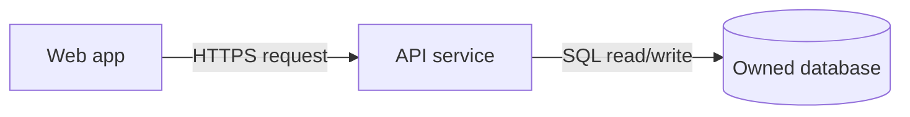

# Project understanding outputs

Read [OUTPUT-FORMATS.md](OUTPUT-FORMATS.md) for document headers, splitting rules and Mermaid wrappers.
These are existing-system knowledge artifacts, not a brief or proposed technical design. Produce one
overview and one separate System graph; extract details only when they need their own maintained source.
Replace examples with evidence. Omit irrelevant detail headings, but account for every coverage row.
Runtime lifecycle and review remain in Alice metadata, not a second status in the body. Project-file
front matter remains limited to id, title and optional source_url.

## Overview template

```markdown
# <System> — Project understanding
- Type: Project understanding.
- Scope: <system and inspected boundaries; overview or focused question>.
- Source: <request and evidence repositories>.
- Related documents: <System graph title + id/path; existing detail titles + id/path + sections>.

## Purpose and capabilities
<Business purpose, users, main capabilities and boundaries.>

## Source baselines and coverage
| Repository/source | Identity/location | Commit or other baseline | Observed at | Covered paths | Working-tree evidence | Not rechecked / limits |
|---|---|---|---|---|---|---|
| <source> | <non-secret identity> | <commit or unavailable> | <date/time> | <paths> | <staged/unstaged/untracked evidence or clean> | <scope limits> |

| Category | Evidence / not applicable / not inspected | Authoritative detail reference | Gap or reason |
|---|---|---|---|
| Business capabilities | <state> | <reference> | <gap/reason> |
| Architecture and boundaries | <state> | <reference> | <gap/reason> |
| Code structure and entry points | <state> | <reference> | <gap/reason> |
| APIs and contracts | <state> | <reference> | <gap/reason> |
| Component responsibilities and data ownership | <state> | <reference> | <gap/reason> |
| Technology stack | <state> | <reference> | <gap/reason> |
| Internal and external dependencies | <state> | <reference> | <gap/reason> |
| Build, test, run and deploy facts | <state> | <reference> | <gap/reason> |
| Tests, CI and code quality facts (no scores) | <state> | <reference> | <gap/reason> |

## Capability and flow map
| Capability | Flow | Services/modules | Entry points and code | Owning detail |
|---|---|---|---|---|
| <capability> | <flow> | <parts> | <repo:path → symbol> | <title + id/path + section> |

## Development facts
| Action | Command/configuration | Source | Found or executed | Result / limitation |
|---|---|---|---|---|
| <build/test/run/deploy> | <non-secret command> | <repo:path> | <found/actually executed> | <result; production use unverified if applicable> |

## Evidence and open boundaries
| Claim | Class | Evidence | Consequence / follow-up |
|---|---|---|---|
| <claim> | <verified fact/inference/conflict/unknown> | <repo:path → symbol at baseline, document section, or unavailable> | <what can/cannot be concluded> |

## Refresh summary
- Reused: <scope and why evidence is sufficient>.
- Re-inspected: <paths, flows and baseline/dirty-state comparison>.
- Changed: <facts added/changed/removed and updated detail/graph references>.
- Not rechecked: <retained coverage with earlier evidence; no global freshness claim>.
```

## Optional detail template

Use for a service/module, contract or cross-component flow only when independent maintenance helps.
The overview links here instead of duplicating evolving detail.

```markdown
# <System> — <Service/module/flow>
- Type: <Component knowledge | Flow knowledge | Contract knowledge>.
- Scope: <specific responsibility or flow>.
- Source: <repositories, paths and inspected baseline/date/working-tree evidence>.
- Related documents: <overview and graph title + id/path + section>.

## Responsibility and boundaries
<Purpose, entry points, data ownership and what belongs elsewhere.>

## Behavior and connections
<Relevant APIs/events, callers/consumers, stores, failure paths, evidence and limitations.>
<For detailed time ordering, add a sequenceDiagram with the shared Purpose/Explanation wrapper.>

## Evidence and freshness
<Verified facts, inferences, conflicts, unknowns; inspected scope and not-rechecked areas.>
```

## System graph template

Always save this as a separate artifact linked to the overview. Keep graph source in the Markdown
body (a separate Alice Document or .alice/docs/ Markdown file), not an image-only attachment.

````markdown
# <System> — System graph
- Type: System graph.
- Scope: <main components covered; omitted or inaccessible areas>.
- Source: <repository baselines, observation dates, working-tree evidence>.
- Related documents: <overview title + id/path; owning detail sections>.

## System overview
Purpose: <what these boundaries and relationships explain>.



Explanation: <Replace the example with supported as-inspected relationships. Define node IDs,
boundaries and edge meanings. State that configured behavior is not proof of production behavior.>

## Graph evidence and navigation
| Node or edge | Class | Source at baseline | Owning detail | Limitation |
|---|---|---|---|---|
| <stable node id or from → to + label> | <verified fact/inference/conflict/unknown> | <repo:path → symbol> | <title + id/path + section> | <limit> |

## Unconfirmed relationships
<Keep unsupported links here, or explicitly distinguish them in the diagram; never show them as facts.>

## Detailed views
<Add smaller flowcharts with the shared Purpose/Explanation wrapper when the overview becomes dense.
Keep stable IDs and links to the relevant detail. Sequence diagrams live in flow documents.>

## Refresh scope
<Which nodes/edges were rechecked, what changed, and which retained areas keep earlier evidence.>
````
