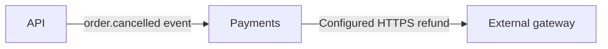

# alice-understand qualification evidence

- Type: Qualification evidence.
- Scope: Author-driven walkthrough and executable storage/install checks; not an independent agent evaluation.
- Source: tests/system/project-understanding.test.ts; tests/system/cli.test.ts; tests/system/local-integrations.test.ts; skill/alice-understand/.

## Inspected fixtures and actual outcomes

The executable walkthrough creates two temporary git repositories, `api` and `payments`. Their initial
commits are recorded at runtime. The test changes the API without changing HEAD: a staged contract,
an unstaged publisher edit, and an untracked consumer. It reads status and both diffs before writing
knowledge. It checks all source file contents and working-tree status remain identical afterwards.
Only fixture setup modifies those sources; the knowledge-writing portion does not.

| Observation | Evidence | Classification / conclusion |
|---|---|---|
| Cancellation publishes an event | api/routes.js, recorded baseline and unstaged diff | Code fact, not observed production delivery |
| Payments subscribes to the original event | payments/consumer.js at its baseline | Code fact; its compatibility with the new producer remains unresolved |
| README describes a different event | api/README.md versus api/routes.js | Conflict explicitly retained |
| A gateway URL is configured | payments/gateway.js | Configuration fact; gateway source and production use unknown |
| A test command exists | api/package.json scripts.test | Found, not executed; no test success or coverage claim |
| Same HEAD contains changed behavior | git status, staged/unstaged diff, untracked file | Commit alone is insufficient for freshness |
| API-only refresh leaves payment detail intact | Stored body/revision before and after | Prior evidence preserved, payment scope marked not rechecked |

The same project also exercises a focused monolith view: the API repository's route, package command,
contract and local consumer can be inspected without assuming access to all external implementations.
For a full overview, TEMPLATE.md accounts for all nine coverage categories; the small fixture has no
deployment evidence, owned database or test coverage evidence, so these remain gaps, not invented facts.

## Recorded graph source

Purpose: Demonstrate the initial as-inspected business relationship from both repositories.



Explanation: `api` and `payments` come from the fixture code. `gateway` is a configured external
boundary. Delivery guarantees, gateway implementation and production use are unverified. During the
focused refresh, the API event changes to v2 and consumer compatibility is explicitly unresolved;
there is no claim that the whole system was rechecked. Mermaid source was inspected but not rendered
or checked with a Mermaid parser.

## Persistence and installation evidence

- A temporary Alice server receives overview, payment detail and a separate graph via public HTTP.
  Project links and typed `references` relations are created separately. Search finds the knowledge
  through curated keywords/tags. No review action is issued.
- Updating the graph preserves its ID, increments its revision to 2 and leaves reviewedAt null. The
  unrelated payment detail is byte-for-byte unchanged. Existing reference links still resolve.
- Project-file output consists of three Markdown documents under a temporary `.alice/docs/`, with
  only id/title front matter, body references and fenced Mermaid source. It does not introduce runtime
  lifecycle fields or require importing a new artifact type.
- Standalone CLI tests install the new skill from a directory with only alice.js for both Codex and
  Claude Code, at user and project scope, checking source/shared file equality and version reporting.
- Local integration tests remove the new skill from a temporary enabled client's installation and
  verify refresh reinstalls it. A disabled client's stale files remain unchanged.

## Requirement coverage

| Requirement | Evidence and verification boundary |
|---|---|
| REQ-001 | Overview/focused/refresh routes reviewed in SKILL.md; fixture supplies both repo and focused views. No independent model-routing test. |
| REQ-002 | Nine-row coverage template and capability-to-code map inspected; fixture facts and missing deployment/quality evidence recorded. |
| REQ-003 | Conflict, unknown gateway, commands-found distinction and dirty-state evidence in walkthrough outputs. |
| REQ-004 | Separate linked documents, keyword/tag discovery, stable detail identity and project-file body links verified via public seam. |
| REQ-005 | Separate Mermaid graph persisted and refreshed; labelled edges, stable IDs, source evidence and unknowns inspected. No renderer claim. |
| REQ-006 | Guidance in all four existing skills plus shared knowledge guide inspected for code-first/overview-first use and selective maintenance. Independent task execution remains untested. |
| REQ-007 | Same-HEAD dirty states and focused graph revision tested; untouched detail retained. Missing-history fallback inspected in skill, not a new scanner algorithm. |
| REQ-008 | Source snapshots unchanged, no implicit reviews, no deployment or tasks created by the walkthrough. Temporary isolated storage only. |

## Reproduction

```bash
npx vitest run tests/system/project-understanding.test.ts tests/system/cli.test.ts tests/system/local-integrations.test.ts tests/unit/skill-workspace-choice.test.ts tests/unit/alice-understand.test.ts
npm run typecheck
npm test
npm run build
```

All test temporary directories use testDir and are cleaned by the test harness. Set ALICE_KEEP_TEST_DIRS=1
when artifacts need inspection. This evidence checks the authored workflow and real storage/install
seams, not that every future agent will follow the prose. Independent real-project forward-testing is
a useful next evaluation; it is not reported as performed here.
